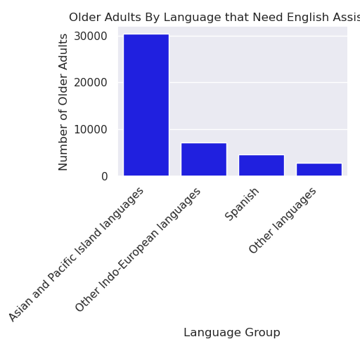
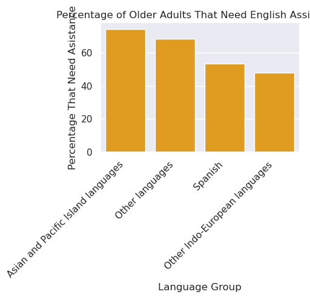
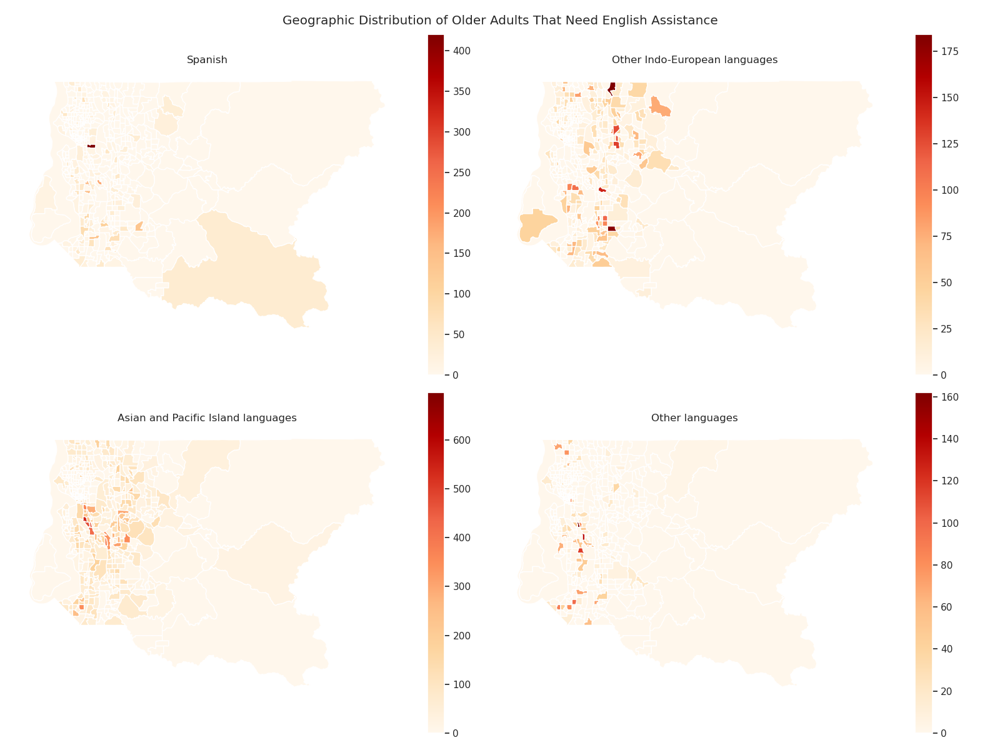
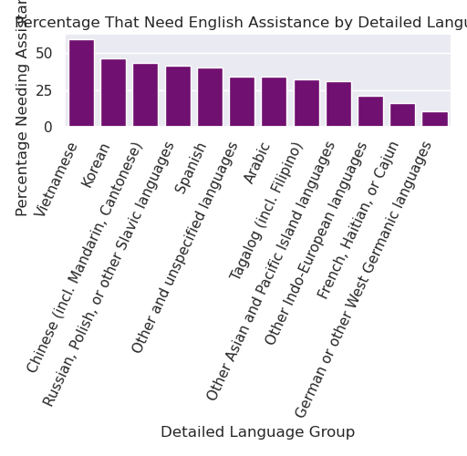
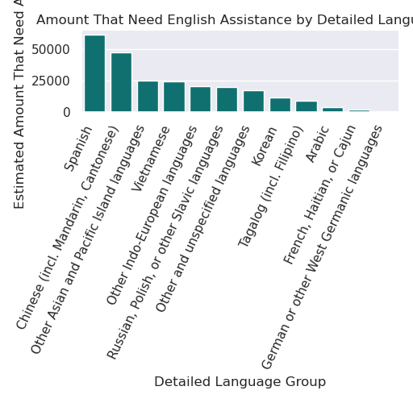

# Language Access Needs for Older Adults in King County

**Authors:** Falinna Fang, Yao Chen, Landy Zhong  
**GitHub Repository:** https://github.com/ffang24-design/Final-Project-Part-2

## Summary of Research Questions

We investigate three questions: 
(1) Which language groups among King County adults aged 65+ have the greatest estimated need for English assistance? 
(2) How well do Sound Generations' documented program languages meet those needs? 
(3) What differences between linguistic communities are obscured by broad census categories? 
We use ACS B16004 for older adults and C16001 for detailed language context among residents aged 5+; the latter cannot identify older-adult needs by individual language.

## Motivation

Language barriers can complicate older adults' access to transportation, healthcare, and social services. This topic is personally meaningful to our team because of our experiences with languages other than English and our concerns about aging family members navigating unfamiliar services. Identifying where English assistance needs are concentrated could inform language-matched outreach and reveal gaps in available data and programming.

## Dataset

We use 2024 ACS five-year estimates for 495 King County census tracts and 2020 Census tract boundaries. B16004 provides four broad non-English language groups and an age 65+ breakdown (495 × 273 raw; 495 × 136 cleaned; 1,980 tract-language records). C16001 provides 12 detailed language groups for residents aged 5+ (495 × 157 raw; 495 × 78 cleaned; 5,940 tract-language records). All 495 ACS GEOIDs matched the geographic boundaries. The proposed Sound Generations site/language list was unavailable for this analysis; therefore, service coverage cannot yet be evaluated.

The cleaned wide ACS tables have no missing values, but derived percentages are undefined for 807/1,980 B16004 records (40.76%) and 1,490/5,940 C16001 records (25.08%), often because the denominator is zero. Coefficients of variation are missing for 1,130 B16004 records (57.07%) and 3,025 C16001 records (50.93%). Undefined values remain missing rather than being converted to zero.

## Method

Using Python, pandas, NumPy, Matplotlib, and GeoPandas, we retrieved ACS estimates and metadata, removed annotation columns, converted numeric fields, handled missing values, and reshaped records into tidy tables. We standardized census tract GEOIDs to 11 digits before joining ACS data to 2020 geographic boundaries. All 495 tracts matched.

We define English assistance need as speaking English less than “very well” (the “well,” “not well,” and “not at all” categories). For each language group, we calculate estimated need counts and percentages of that group's population, and examine margins of error and coefficients of variation. We summarize tract distributions with descriptive statistics, compare broad B16004 groups with detailed C16001 categories, and visualize counts, percentages, and geographic patterns. The two ACS tables describe different age populations and are not directly interchangeable. Site-language matching functions were developed but not applied to a verified Sound Generations site list.

## EDA Results

### Descriptive Statistics

| Statistic | B16004: API 65+ count/tract | C16001: Chinese 5+ count/tract | C16001: county need % by language |
|---|---:|---:|---:|
| Count | 495 | 495 | 12 |
| Mean | 61.24 | 96.43 | 34.14 |
| Standard deviation | 82.67 | 128.04 | 13.43 |
| Minimum | 0 | 0 | 10.94 |
| 25th percentile | 6.50 | 13.00 | 28.36 |
| Median | 36.00 | 49.00 | 33.95 |
| 75th percentile | 82.00 | 136.00 | 42.01 |
| Maximum | 697 | 1,018 | 59.12 |

*Table 1.* Representative seven-number summaries with counts. “API” means Asian and Pacific Island languages. The first two columns summarize estimated people needing assistance per tract; the last summarizes percentages across 12 county-level language categories. Means exceed medians for both tract-level counts, suggesting concentrations in some tracts.

### Older Adults: Broad Language Groups (B16004)

| Language group | Estimated people needing assistance (65+) | Within-group percentage |
|---|---:|---:|
| Asian and Pacific Island languages | 30,314 | 74.34% |
| Other Indo-European languages | 7,187 | 48.23% |
| Spanish | 4,572 | 53.50% |
| Other languages | 2,809 | 68.61% |

Asian and Pacific Island language speakers have the highest estimated count and percentage among the four groups. Figures 1 and 2 show why counts and within-group rates answer different questions.

::: {.figure-pair}

::: {.figure-item}

**Figure 1.** Estimated count of adults aged 65+ needing English assistance by broad language group.

:::

::: {.figure-item}

**Figure 2.** Within-group percentage of adults aged 65+ needing English assistance.

:::

:::

### Geographic Patterns

Figure 3 maps older-adult language assistance needs across 495 tracts (1,980 tract-language observations). Tract-level estimates can have high sampling uncertainty, so apparent hotspots are exploratory, not definitive tract rankings.

**Figure 3.** Geographic distribution of older-adult English assistance needs in King County.

### Detailed Languages and Aggregation (C16001)

Among residents aged 5+, Spanish (61,573), Chinese including Mandarin and Cantonese (47,733), and other Asian and Pacific Island languages (25,302) had the largest estimated assistance-need counts. Vietnamese had a 59.12% within-language need rate, compared with Korean at 46.32% and Chinese at 43.03%. Figures 4 and 5 show the differences between ranking by percentage and by count.

::: {.figure-pair}

::: {.figure-item}

**Figure 4.** Within-language English assistance-need percentages, ages 5+.

:::

::: {.figure-item}

**Figure 5.** Estimated English assistance-need counts by detailed language, ages 5+.

:::

:::

All 12 detailed categories were mapped to the four broad groups. Within the detailed Asian and Pacific Island group, Chinese accounted for 40.26% of estimated assistance need, other Asian and Pacific Island languages for 21.34%, and Vietnamese for 20.59%. Broad categories therefore conceal substantial variation. These ages 5+ figures are not estimates specifically for older adults. Without the Sound Generations site list, we cannot establish whether service offerings match these needs.

## Challenge Goals Update

**Multiple Datasets:** We cleaned and compared B16004 and C16001, standardized language categories, and successfully joined tract estimates to geographic boundaries. Integrating the Sound Generations program-site list remains unfinished.

**Messy Data:** ACS variable codes, annotations, missing-value representations, geographic identifiers, and inconsistent language groupings required metadata-based parsing, numeric conversion, reshaping, and standardization. We tested cleaning and site-language deduplication functions; source-level validation and site integration remain important next steps.

## Work Plan Evaluation

Our original proposal estimated approximately 15 hours for data collection, cleaning, analysis, visualization, testing, and reporting. At the EDA stage, our team spent approximately 11.5 hours: Falinna Fang contributed 3.5 hours, Landy Zhong contributed 3 hours, and Yao Chen contributed 5 hours.

We completed ACS data cleaning, statistical analysis, geographic visualizations, and automated testing. Remaining tasks include integrating Sound Generations program-site information, validating the findings, and preparing the final deliverables. The actual time spent is below the original estimate because the project is still in progress.

## Testing

We used src/test_data_cleaning.py (8 passing tests) and src/test_eda_stats.py (5 passing tests). These cover GEOID construction, missing-value and annotation handling, ACS label parsing, age-specific need calculations, percentages and coefficients of variation, language mapping, site-language cleaning, missingness summaries, descriptive statistics, categorical counts, broad/detailed comparisons, and site counts. All 13 tests passed locally, and python3 -m flake8 src reported no violations. Tests use controlled examples and do not eliminate uncertainty in the underlying ACS estimates.

## Collaboration

Falinna Fang, Yao Chen, and Landy Zhong collaborated through a shared GitHub repository on data collection, cleaning, analysis, visualization, testing, and reporting. Falinna focused on data collection and language-needs analysis, Landy on program coverage analysis, and Yao on automated testing, validation, and report integration. Team members coordinated their work through GitHub, reviewed project progress, and contributed to the overall analysis and documentation.
